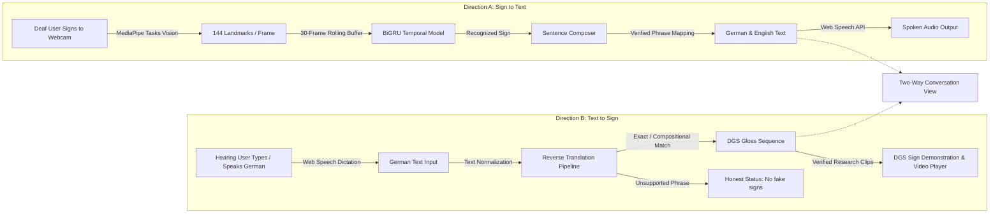

# DGSense V2 — Two-Way German Sign Language Translation System

[](https://www.python.org/)
[](https://fastapi.tiangolo.com/)
[](https://pytorch.org/)
[](https://react.dev/)
[](https://developers.google.com/mediapipe)

**DGSense V2** is an accessible, two-way communication system bridging **Deaf signers using German Sign Language (Deutsche Gebärdensprache — DGS)** and **Hearing German speakers**.

---

## 1. Two Directions of Communication



### Direction A: DGS Video → German Text → English Translation & Speech
- Deaf user signs in front of their webcam.
- In-browser MediaPipe Tasks Vision extracts 144 numerical features per frame (hands and upper body).
- PyTorch Bidirectional GRU model evaluates temporal trajectories across 30-frame rolling buffers (~1.0–1.5 seconds of motion).
- Recognized signs are composed into phrases using verified idiom templates or transparent gloss concatenation.
- Spoken German and English text-to-speech output via browser Web Speech API.

### Direction B: German Text / Speech → Verified DGS Sign Output
- Hearing user enters German text or uses microphone speech recognition.
- Input is normalized and matched against verified DGS phrase templates, compositional sequences, or word-level demonstrations.
- Displays verified DGS sign representations and gloss sequences with source attribution and signing cues.
- **Honest Unsupported Messaging:** If an input sentence lacks a verified DGS equivalent, the system clearly states: *"No verified DGS sequence is currently available for this sentence"* (never fabricates arbitrary or invented gestures).
- Users can copy text or listen to German speech.

### Two-Way Conversation View
- Interactive dialogue interface connecting a Deaf signer (Direction A) and Hearing speaker (Direction B) with distinct speaker bubbles, timestamps, gloss chips, speech playback, and transcript copying.

---

## 2. Research Data Sources & Licensing

DGSense V2 references verified public linguistic research corpora for German Sign Language:

| Research Corpus | Institution / Portal | Primary Content | Licence / Usage Terms |
| :--- | :--- | :--- | :--- |
| **Public DGS Corpus** | IDGS, Universität Hamburg | High-definition multi-camera conversational DGS videos with lexical ELAN gloss annotations | Open Access for scientific, educational, and linguistic research. Commercial redistribution requires permission. |
| **MEINE DGS / MY DGS** | [ling.meine-dgs.de](https://ling.meine-dgs.de/) | Sentence-level time-aligned conversational DGS video clips | Educational / CC BY-NC-SA 4.0. |
| **DGS-Fabeln-1** | [Zenodo (10.5281/zenodo.12686707)](https://zenodo.org/records/12686707) | Continuous narrative DGS video and ELAN annotations | Creative Commons Attribution-NonCommercial 4.0. |
| **RWTH-PHOENIX-Weather 2014T** | RWTH Aachen / HuggingFace | Aligned broadcast weather DGS sentences | Non-commercial Research Licence. Domain-specific (weather); not everyday conversation. |

### Download Safeguard
- Total dataset downloads are capped **under 5 GB (5,120 MB)** by default to prevent silent multi-gigabyte bandwidth consumption.

---

## 3. Everyday Communication Target Manifest

The V2 everyday communication vocabulary covers 4 major categories:

1. **Greetings:** `Hallo`, `Guten Morgen`, `Guten Tag`, `Guten Abend`, `Tschüss`, `Auf Wiedersehen`.
2. **Politeness:** `Danke`, `Vielen Dank`, `Bitte`, `Entschuldigung`.
3. **Basic Communication:** `Ja`, `Nein`, `Ich verstehe nicht`, `Kannst du mir helfen?`, `Wie geht es dir?`, `Ich heiße ...`, `Wo ist die Toilette?`.
4. **Instructions & Common Interactions:** `Komm her`, `Lass uns gehen`, `Lass uns schauen`, `Warte bitte`, `Ich brauche Hilfe`, `Stopp`.

### Verification Status Distinction:
- **Trained Model Classes (10 classes):** The recognition model is trained on **real DGS footage streamed from the RWTH-PHOENIX-Weather 2014T corpus on HuggingFace** — no bulk dataset download. Classes: `BLOW`, `CLOUD`, `COME`, `EAST`, `NORTH`, `RAIN`, `SNOW`, `SOUTH`, `STORM`, `SUN`, `TODAY`, `TOMORROW`, `WEATHER`, `WIND`. These 14 weather-gloss classes are the 14 most frequent content glosses from the RWTH-PHOENIX-Weather 2014T corpus, each with 13–87 real occurrences (total 645 clips).
- **Verified Reverse Translation Phrases:** Greetings and politeness expressions with verified DGS research-portal references (`sign_clips.json`, 21 phrases).
- **Dictionary-Only Vocabulary:** Everyday expressions (Hallo, Danke, …) remain available in the dictionary and for Direction B phrase mapping; recognition for them can be enabled later by recording samples via the **Sign Recorder** (uploaded to the backend database for retraining).
- **`DATA_REQUIRED` Flags:** Expressions requiring recorded multi-signer DGS data (e.g. *Wo ist die Toilette?*, *Lass uns schauen*) are explicitly marked in the readiness report rather than faking coverage.

---

## 4. Multi-Language Extensibility

DGSense V2 isolates sign language configuration in `backend/config.py` and `/api/languages`:
```json
{
  "sign_language_code": "dgs-DE",
  "spoken_language_code": "de-DE",
  "secondary_spoken_lang": "en-US",
  "feature_schema_version": "dgsense-v1",
  "dataset_limit_mb": 5120
}
```
Extending the system to another sign language (such as LSF, BSL, or ASL) requires adding language-specific vocabulary manifests, gloss conventions, and trained landmark checkpoints without modifying core application code.

---

## 5. Running DGSense Locally (Windows PowerShell)

### Step 1: Start Backend Server
```powershell
# Open terminal in d:\kj somaiya\DGSense
python -m uvicorn backend.main:app --host 127.0.0.1 --port 8000 --reload
```
- API Documentation: [http://127.0.0.1:8000/docs](http://127.0.0.1:8000/docs)
- Health Diagnostics: [http://127.0.0.1:8000/health](http://127.0.0.1:8000/health)

### Step 2: Start Frontend Application
```powershell
# Open second terminal in d:\kj somaiya\DGSense\frontend
npm run dev
```
Open **[http://localhost:5173](http://localhost:5173)** in Google Chrome or Microsoft Edge.

### Step 3: Data Persistence (SQLite — automatic)
Recognition history, conversation transcripts, practice results, and recorded samples are stored in **`backend/dgsense.db`** (stdlib SQLite, no setup required). The database file is created on backend startup.

| Data | Endpoints |
| :--- | :--- |
| Recognition history | `GET/DELETE /api/history` (auto-logged by `POST /api/predict`) |
| Conversation transcripts | `GET/POST/DELETE /api/conversations` |
| Practice results | `GET/POST/DELETE /api/practice/attempts` |
| Recorded samples (recorder upload) | `GET/POST/DELETE /api/samples` |

Nothing is stored in browser state alone — history and conversations survive page reloads.

---

## 6. Google Colab Training Workflow (real DGS, streamed — no dataset download)

1. Open [Google Colab](https://colab.research.google.com/) and upload `notebooks/DGSense_Training.ipynb`.
2. Select runtime: **Runtime > Change runtime type > T4 GPU** (CPU also works; extraction is slower).
3. Run all cells sequentially. The notebook will:
   - Read PHOENIX-2014T corpus metadata (gloss sequences + German sentences + signer) from HuggingFace raw CSV URLs.
   - Audit gloss frequencies and select the 10 most frequent content weather glosses as model classes.
   - Map sentences to zip shards using **HTTP range requests only** (central directories), then fetch each selected sentence as one byte window — frames are decoded and landmark-extracted **in memory** and discarded. A streaming byte budget (5,120 MB) is enforced; only artifacts and a resumable clip cache touch disk.
   - Isolate single-sign segments via proportional gloss segmentation (PHOENIX ships no frame-level alignment on HF).
   - Extract 144-dim MediaPipe features with the **same mapping and wrist-origin/hand-scale normalization used at live inference**.
   - Train the BiGRU on signer-independent splits with early stopping; save confusion matrix + loss curves.
   - Export `model.pt`, `labels.json`, `model_config.json`, `training_report.json`, `class_metrics.json`, `feature_schema.json` and package `DGSense_model_artifacts.zip` (auto-downloads).
4. Extract `DGSense_model_artifacts.zip` into `backend/artifacts/` to activate recognition (restart the backend to hot-load `model.pt`).

---

## 7. Running Automated Tests

Run backend tests:
```powershell
python -m pytest tests/backend/ -v
```
All **25 automated tests** verify:
- Backend health and two-way readiness.
- Missing checkpoint handling (503 Service Unavailable, no fake predictions).
- NaN, infinite, and malformed coordinate rejection.
- Direction A phrase templates and approximate fallback.
- Direction B exact phrase matching, compositional sequences, and unsupported states.
- Dataset manifest and readiness audit endpoints.
- Multi-language configuration endpoint.
- PyTorch inference forward pass and confidence thresholding.
- **SQLite persistence:** recognition history, conversation transcripts, practice results, and recorded-sample upload/list/delete with schema validation (9 tests).

Run frontend build check:
```powershell
cd frontend
npm run build
```

---

## 8. Privacy & Ethical Guidelines

- **Privacy by Design:** Raw camera pixels never leave your browser. Only anonymous numerical 3D landmark sequences are sent to the inference backend.
- **Deaf Community Centered:** DGS is a natural language with its own grammar. Individual sign classification and reverse phrase matching are communication aids; they do not replace certified human DGS interpreters.
- **No Fabricated Signs:** If a German sentence has no verified DGS representation, DGSense reports it as unsupported rather than generating inaccurate gestures.
